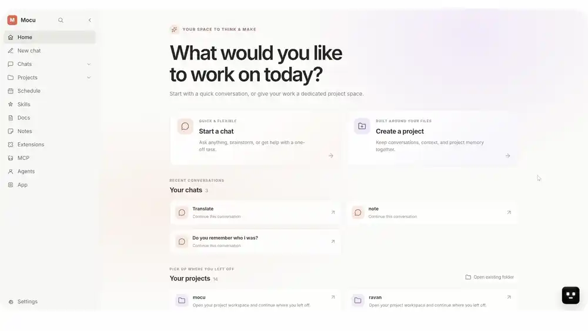

# مکو — همکار متن‌باز هوش مصنوعی شما

**مکو جایگزین شما نیست؛ همکار شماست—برای انجام کارها با بهره‌وری بیشتر.**

**زبان‌ها:** [English](README.md) · [فارسی](README.fa.md)

<p align="center">
  <a href="public/github.mp4" title="پخش ویدیوی نمایشی مکو با کیفیت کامل">
    
  </a>
  <br/>
  <sub><a href="public/github.mp4">▶ ویدیوی نمایشی با کیفیت کامل را باز کنید (۲۳ ثانیه، با صدا)</a></sub>
</p>

<p align="center">
  
  
  
  
</p>

**مکو یک فضای کاری دسکتاپِ آزاد و متن‌باز برای هوش مصنوعی است.** به‌جای اجارهٔ یک دستیار چت بسته، تمام کارگاه را در اختیار دارید: ایجنت‌های شخصی، اسکیل‌ها، اکستنشن‌ها، اپ‌های درون‌برنامه‌ای، اسناد و نوت‌های خودتان، حافظهٔ پروژه، زمان‌بندی و کنترل کامپیوتر و مرورگر—روی **هر مدلی که خودتان انتخاب کنید**.

**[وب‌سایت](https://kharchangai.github.io/Mocu/fa.html) · [دریافت نسخهٔ ویندوز](https://github.com/kharchangai/Mocu/releases) · [راهنمای نصب](https://kharchangai.github.io/Mocu/install.html) · [مستندات](install-resources/docs/mocu-user-guide.md) · [اشکال و بازخورد](https://github.com/kharchangai/Mocu/issues)**

---

## ایده: کارگاه را داشته باشید، نه فقط پاسخ را

ChatGPT، Claude، Grok، Muse و مشابه‌ها دستیار خوبی در جعبهٔ کسی دیگر به شما می‌دهند. خوب جواب می‌دهند—اما مالکِ نحوهٔ فکر کردن، چیزهایی که به یاد می‌سپارند و ابزارهایی که در اختیار دارند نیستید. نمی‌توانید فایل‌ها، ابزارها و قواعد خودتان را به آن‌ها داد و بعد سیستم‌های خودتان را روی آن ساخت.

مکو مسیر دیگری را انتخاب می‌کند. همان بلوک‌های سازنده، اما باز، قابل‌بررسی و از آنِ خودتان:

| | یک دستیار چت بسته | **مکو** |
|---|---|---|
| **هزینه** | اشتراک ماهانه به‌ازای هر کاربر | آزاد و متن‌باز (Apache 2.0)؛ فقط هزینهٔ سرویس‌دهندهٔ مدل را می‌پردازید |
| **مدل** | همان که داده می‌شود | هر سرویس‌دهندهٔ سازگار با OpenAI: مدل‌های قدرتمند، ارزان یا محلی |
| **حافظه** | روی سرورهای شرکت سازنده | فایل‌های ساده در پوشه‌های خودتان—قابل خواندن، ویرایش و پشتیبان‌گیری |
| **ابزار** | فهرست ثابت امکانات | ایجنت، اسکیل، اکستنشن، اپ و MCP—ساخته‌شده برای کار شما |
| **خودکارسازی** | یک پنجرهٔ چت | اجرای زمان‌بندی‌شدهٔ ایجنت‌ها، کنترل کامپیوتر، استفاده از مرورگر، اعلان‌ها |
| **گسترش‌پذیری** | بسته | SDKهای Node.js و Python، به‌همراه کدی که می‌توانید بخوانید و تغییر دهید |

**صادقانه:** مکو خودش مدل ندارد. شما کلید API (یا یک مدل محلی) می‌آورید، پس هزینهٔ مصرف را سرویس‌دهنده محاسبه می‌کند—اما هیچ اشتراک مکو، هیچ هزینهٔ به‌ازای کاربر و هیچ محدودیتی برای استفاده از مدل ارزان یا خودمیزبان وجود ندارد. همین است که سیستم‌های چند‌ایجنتِ طولانی‌مدت را مقرون‌به‌صرفه می‌کند.

## پیچیدگی را یک‌بار بسازید—بعد همیشه استفاده کنید

در مکو همه‌چیز یک بلوک سازنده است که می‌توانید ترکیب کنید:

| بلوک سازنده | چه چیزی به شما می‌دهد |
|---|---|
| **ایجنت‌ها** | متخصص‌هایی با دستورالعمل، ابزار، اسکیل، مدل و زیرایجنتِ خودشان. نقش را به زبان ساده بگویید و مکو می‌سازد. |
| **اسکیل‌ها** | روش‌های قابل‌استفادهٔ دوباره: کار چطور و با چه سبکی انجام شود. |
| **اکستنشن‌ها و اپ‌ها** | ابزار و اتصال‌های تازه—و اپ‌های کوچک با رابط اختصاصی برای کارهای تکراری. |
| **اسناد و حافظه** | واقعیت‌ها و روش‌های شما، هنگام نیاز بازیابی می‌شوند؛ حافظهٔ پروژه کارهای طولانی را پیوسته نگه می‌دارد. |
| **نوت‌ها و زمان‌بندی** | زمینهٔ شخصی که همراه شماست، به‌همراه یادآورها و اجرای خودکار ایجنت‌ها. |
| **کامپیوتر و مرورگر** | ایجنت‌هایی که می‌توانند اپ‌های واقعی و یک نشست واقعی مرورگر را اداره کنند—با نظارت شما (`/focus` و `/step` برای کارهای طولانی). |

آن‌ها را زنجیره کنید تا سیستم‌های واقعاً پیچیده بسازید: یک ایجنت پژوهش که کار را به نویسنده و بازبین واگذار می‌کند، اسکیلی که قواعد ویرایشی شما را اعمال می‌کند، اکستنشنی متصل به ابزار انتشارتان، و خلاصهٔ صبحگاهی که هر روز اجرا می‌شود—چه یادتان باشد چه نه.

## در نسخهٔ ۰٫۳ منتشر شد

- **حافظه و تاریخچهٔ پروژه** — پروژه‌های طولانی دیگر از صفر شروع نمی‌شوند و می‌توانید تغییرات را مرور کنید.
- **کنترل کامپیوتر و پل مرورگر** (آلفا) — ایجنت‌هایی که اپ باز می‌کنند، اسکرین‌شات می‌گیرند، کلیک و تایپ می‌کنند و در مرورگر واقعی کار می‌کنند.
- **تولید تصویر و ویدئو** و **پیش‌نمایش‌های تعاملی جاوااسکریپت** در دل گفت‌وگو.
- **اعلان‌های دسکتاپ** — ایجنت‌ها و اکستنشن‌ها می‌توانند هشدار همیشه-روی-صفحه با HTML/CSS سفارشی، صدا و موقعیت دلخواه بفرستند.
- **اپ‌های آماده** — PDF Reader، معلم زبان، خبرخوان، تحلیل یوتیوب، SSH، تلگرام و بیشتر.
- **حافظهٔ ارزان‌تر و بهینه‌تر** و **گردش‌کار کدنویسی ترمینال‌محور** برای ایجنت‌ها.

جزئیات کامل: [نسخه‌ها](https://github.com/kharchangai/Mocu/releases) · [نقشهٔ راه](https://kharchangai.github.io/Mocu/#roadmap).

## مناسب چه کسانی است

- **توسعه‌دهندگان و بنیان‌گذاران فنی** — نقشه‌ای که می‌توانید بررسی، گسترش و منتشرش کنید.
- **سازندگان محتوا و بازاریاب‌ها** — زنجیرهٔ پژوهش ← نوشتن ← بازبینی که از سبک شما پیروی می‌کند و زمینهٔ کمپین را نگه می‌دارد.
- **کسب‌وکارهای تک‌نفره و تیم‌های کوچک** — خلاصه‌ها، گزارش‌ها و یادآورهایی که بدون یادآوری کسی اجرا می‌شوند.
- **هر کسی که می‌خواهد اشتراک را جایگزین کند** — همان توانایی‌های روزمره، با کلیدها، فایل‌ها و قواعد خودتان.

## در چند دقیقه شروع کنید

**[دریافت نصب‌کنندهٔ ویندوز →](https://github.com/kharchangai/Mocu/releases)** (macOS و Linux امروز از روی کد منبع ساخته می‌شوند)

1. **تنظیمات** را باز کنید و یک سرویس‌دهندهٔ سازگار با OpenAI اضافه کنید: کلید API، آدرس پایه و نام مدل‌ها.
2. متخصص مورد نیازتان را توضیح دهید و از مکو بخواهید بسازدش.
3. یک سند دانش و یک نوت دربارهٔ شیوهٔ کاری‌تان اضافه کنید.
4. اکستنشن‌های لازم را نصب و با `/extension` انتخاب کنید.
5. یک **پروژه** برای کارهای ادامه‌دار باز کنید و `/focus` یا `/step` را امتحان کنید.

برای اکستنشن‌های Node به Node.js، برای اکستنشن‌های Python به Python و برای جست‌وجوی وب به کلید Perplexity نیاز دارید.

## پرسش‌های رایج

**آیا مکو واقعاً رایگان است؟**
بله—Apache 2.0، بدون اشتراک و بدون محدودیت تعداد کاربر. هزینهٔ مدل و API را سرویس‌دهنده‌ای که تنظیم می‌کنید محاسبه می‌کند.

**آیا کارهایی که ChatGPT، Claude یا Grok انجام می‌دهند را می‌کند؟**
برای چت، نوشتن، پژوهش، کدنویسی و کار با تصویر بله—با مدل دلخواه شما. چیزی که اضافه می‌کند مالکیت است: ایجنت‌ها، فایل‌ها، حافظه، ابزارها و خودکارسازی روی دستگاه خودتان و در کنترل خودتان می‌مانند.

**آیا باید برنامه‌نویسی بدانم؟**
نه. ایجنت، اسکیل، اکستنشن یا اپی که می‌خواهید را به زبان ساده توضیح دهید. توسعه‌دهندگان می‌توانند با SDKهای همراه عمیق‌تر بروند.

**آفلاین کار می‌کند؟ داده‌هایم کجاست؟**
برنامه، پروژه‌ها، نوت‌ها، اسناد و حافظه به‌صورت محلی ذخیره می‌شوند (حافظهٔ پروژه در `.mocu/`). فراخوانی مدل به سرویس‌دهنده می‌رود، پس پاسخ‌ها به اتصال نیاز دارند مگر اینکه به مدل محلی وصل شوید. هیچ‌چیز به سرور مکو فرستاده نمی‌شود—[سیاست حریم خصوصی](PRIVACY.md) را ببینید.

**پایدار است؟**
در مرحلهٔ آلفاست. انتظار اشکال و تغییرات ناسازگار میان نسخه‌ها را داشته باشید، خروجی و اقدامات کامپیوتری را بازبینی کنید و از فایل‌های مهم پشتیبان بگیرید.

## ساخت از روی کد منبع

بک‌اند **Tauri 2 + Rust** و رابط کاربری **React + TypeScript + Vite**. به Git، Rust stable، Node.js 22.12+، [پیش‌نیازهای Tauri](https://v2.tauri.app/start/prerequisites/) برای سیستم‌عامل‌تان و در صورت نیاز Python 3 برای اکستنشن‌های پایتون نیاز دارید.

```bash
git clone https://github.com/kharchangai/Mocu.git
cd Mocu
npm install
npm run tauri dev     # اجرای برنامهٔ دسکتاپ
npm run tauri build   # ساخت نصب‌کننده برای همین سیستم‌عامل
```

مراحل نصب برای ویندوز، macOS و Ubuntu/Debian در [راهنمای نصب](https://kharchangai.github.io/Mocu/install.html) آمده است.

## اطلاعات بیشتر

- [راهنمای کاربر](install-resources/docs/mocu-user-guide.md) · [ایجنت‌ها](install-resources/docs/mocu-agents.md) · [اسکیل‌ها](install-resources/docs/mocu-skills.md)
- [اکستنشن‌ها](install-resources/docs/mocu-extensions.md) · [توسعهٔ اکستنشن](install-resources/docs/mocu-extension-development.md) · [MCP](install-resources/docs/mocu-mcp.md)
- [پروژه و حافظه](install-resources/docs/mocu-projects.md) · [اسناد دانش](install-resources/docs/mocu-knowledge-docs.md) · [نوت‌ها](install-resources/docs/mocu-notes.md) · [زمان‌بندی](install-resources/docs/mocu-schedule.md)
- [Focus و گام‌به‌گام](install-resources/docs/mocu-chat-commands.md) · [حریم خصوصی](PRIVACY.md) · [امضای کد](CODE_SIGNING.md)

## مجوز

[Apache License 2.0](LICENSE).

---

**کار شما. تیم هوش مصنوعی شما. توان بیشتر برای کارهایی که می‌خواهید.**
