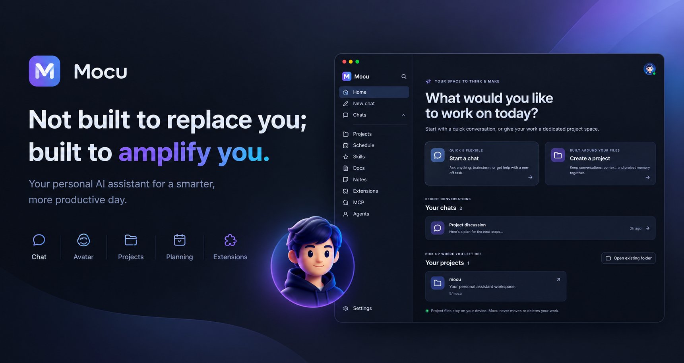

# Mocu — Your open-source AI colleague

**Mocu isn't your replacement. It's your colleague—for getting work done with more productivity.**

**Languages:** [English](README.md) · [فارسی](README.fa.md)

<p align="center">
  
</p>

<p align="center">
  
  
  
  
</p>

**Mocu is a free, open-source desktop AI workspace.** Instead of renting one closed chat assistant, you get the whole workshop: personal AI agents, skills, extensions, in-app apps, your own documents and notes, project memory, scheduling, and computer/browser control—running on **any model you choose**.

**[Website](https://kharchangai.github.io/Mocu/) · [Download for Windows](https://github.com/kharchangai/Mocu/releases) · [Install guide](https://kharchangai.github.io/Mocu/install.html) · [Docs](install-resources/docs/mocu-user-guide.md) · [Issues & feedback](https://github.com/kharchangai/Mocu/issues)**

---

## The idea: keep the workshop, not just the answer

ChatGPT, Claude, Grok, Muse and friends give you an excellent assistant inside someone else's box. It answers well—but you don't own how it thinks, what it remembers, or what it can reach. You can't hand it your files, your tools, your rules, and then build your own systems on top of it.

Mocu takes the other road. The same building blocks are open, inspectable, and yours:

| | A closed chat assistant | **Mocu** |
|---|---|---|
| **Cost** | Monthly subscription per seat | Free and open source (Apache 2.0). You pay only your model provider |
| **Model** | Whatever you're given | Any OpenAI-compatible provider: frontier, budget, or a local endpoint |
| **Memory** | Lives on the vendor's servers | Plain files in your own folders—readable, editable, backup-able |
| **Tools** | Fixed feature list | Agents, skills, extensions, apps, MCP—built to fit your work |
| **Automation** | A chat window | Scheduled agent runs, computer control, browser use, notifications |
| **Extensibility** | Closed | Node.js and Python SDKs, plus source code you can read and fork |

**Honest version:** Mocu doesn't include a model. You bring an API key (or a local model), so usage is billed by your provider—but there's no Mocu subscription, no per-seat fee, and nothing stops you from pointing it at a cheap or self-hosted model. That is what makes long-running, many-agent systems affordable.

## Build complexity once—then reuse it forever

Everything in Mocu is a building block you can combine:

| Building block | What it gives you |
|---|---|
| **Agents** | Specialists with their own instructions, tools, skills, model, and sub-agents. Describe the role in plain language and Mocu creates it. |
| **Skills** | Reusable methods: how the work should be done, in your style. |
| **Extensions & Apps** | New tools and integrations—and small in-app apps with their own interface for repeated jobs. |
| **Docs & Memory** | Your facts and methods, retrieved when relevant; project memory keeps long work continuous. |
| **Notes & Schedule** | Personal context that follows you, plus reminders and automatic agent runs. |
| **Computer & Browser** | Agents that can drive real apps and a real browser session—supervised by you (`/focus`, `/step` for long tasks). |

Chain them and you get genuinely complex systems: a research agent that delegates to a writer and a reviewer, a skill that enforces your editorial rules, an extension wired to your publishing tools, a briefing that runs every morning whether you remember it or not.

## Shipped in 0.3.x

- **Project memory and project history** — long projects stop starting from zero, and you can review what changed.
- **Computer control and browser bridge** (alpha) — agents that can open apps, screenshot, click, type, and work in a real browser.
- **Image and video generation**, plus **interactive JavaScript previews** inside the chat.
- **Desktop notifications** — agents and extensions can raise always-on-top alerts, with custom HTML/CSS, sound, and placement.
- **Apps in the box** — PDF reader, language tutor, news reader, YouTube insights, SSH, Telegram, and more.
- **Cheaper, cleaner memory** and a **terminal-first coding workflow** for agents.

Full details: [releases](https://github.com/kharchangai/Mocu/releases) · [roadmap](https://kharchangai.github.io/Mocu/#roadmap).

## Who it's for

- **Developers and technical founders** — a blueprint you can inspect, extend, and ship on.
- **Creators and marketers** — research → write → review pipelines that follow your style and keep the campaign context.
- **Solo operators and small teams** — briefings, reports, and reminders that run without anyone remembering to start them.
- **Anyone replacing a subscription** — same daily capabilities, your own keys, your own files, your own rules.

## Get started in a few minutes

**[Download the Windows installer →](https://github.com/kharchangai/Mocu/releases)** (macOS and Linux can build from source today)

1. Open **Settings** and add an OpenAI-compatible provider: API key, base URL, model names.
2. Describe the specialist you need and ask Mocu to create it.
3. Add a knowledge doc and a note about how you like to work.
4. Install the extensions you want and select them with `/extension`.
5. Open a **Project** for ongoing work, then try `/focus` or `/step`.

Node.js is required for Node extensions, Python for Python extensions, and a Perplexity key is needed for web search.

## FAQ

**Is Mocu really free?**
Yes—Apache 2.0, no subscription, no seat count. Model and API usage is billed by the provider you configure.

**Can it do what ChatGPT, Claude or Grok do?**
For chat, writing, research, coding and image work, yes—with the model of your choice. What it adds is ownership: your agents, files, memory, tools, and automation stay on your machine and under your control.

**Do I need to know how to program?**
No. Describe the agent, skill, extension, or app you want in plain language. Developers can go deeper with the bundled SDKs.

**Does it work offline / where is my data?**
The app, projects, notes, docs and memory live locally (project memory under `.mocu/`). Model calls go to your provider, so responses need a connection unless you point Mocu at a local model. Nothing is uploaded to a Mocu server—see the [privacy policy](PRIVACY.md).

**Is it stable?**
It's an alpha. Expect bugs and breaking changes between releases, review AI-generated output and computer actions, and back up important files.

## Build from source

**Tauri 2 + Rust** backend, **React + TypeScript + Vite** interface. You need Git, Rust stable, Node.js 22.12+, the [Tauri prerequisites](https://v2.tauri.app/start/prerequisites/) for your OS, and optionally Python 3 for Python extensions.

```bash
git clone https://github.com/kharchangai/Mocu.git
cd Mocu
npm install
npm run tauri dev     # run the desktop app
npm run tauri build   # produce an installer for this OS
```

Per-OS setup steps (Windows, macOS, Ubuntu/Debian) are in the [install guide](https://kharchangai.github.io/Mocu/install.html).

## Learn more

- [User guide](install-resources/docs/mocu-user-guide.md) · [Agents](install-resources/docs/mocu-agents.md) · [Skills](install-resources/docs/mocu-skills.md)
- [Extensions](install-resources/docs/mocu-extensions.md) · [Extension development](install-resources/docs/mocu-extension-development.md) · [MCP](install-resources/docs/mocu-mcp.md)
- [Projects & memory](install-resources/docs/mocu-projects.md) · [Knowledge docs](install-resources/docs/mocu-knowledge-docs.md) · [Notes](install-resources/docs/mocu-notes.md) · [Schedule](install-resources/docs/mocu-schedule.md)
- [Focus & Step-by-Step](install-resources/docs/mocu-chat-commands.md) · [Privacy](PRIVACY.md) · [Code signing](CODE_SIGNING.md)

## License

[Apache License 2.0](LICENSE).

---

**Your work. Your AI team. More of what you can do.**
