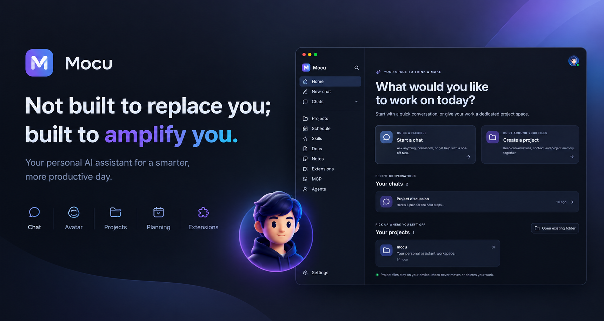

# Mocu — More capability. Still you.

**Languages:** [English](README.md) · [فارسی](README.fa.md)

<p align="center">
  
</p>

<p align="center">
  
  
  
</p>

> **Mocu wasn't built to replace you. It was built to amplify what you can do.**

Mocu is a desktop AI workspace where you build a team of personal agents around the way **you** already work. Teach them your methods, give them your tools and current knowledge, then work with them in one place—from a quick task to a project that runs for months.

- **No programming required.** Describe what you need in plain language; Mocu helps you create the agent, the skill, or the tool.
- **Your judgment stays in charge.** Ideas, decisions, and goals remain yours. The agents do the lifting, not the deciding.
- **Nothing resets between sessions.** Projects, memory, notes, and schedules keep your context alive.

**[Download for Windows](https://github.com/kharchangai/Mocu/releases) · [Build from source](#build-from-source) · [Report a bug](https://github.com/kharchangai/Mocu/issues)**

<!-- Marketing note: a 10–20s screen recording (Focus → agent creating a doc → schedule) placed here converts better than any copy. Add it as public/demo.gif and uncomment:
<p align="center"></p>
-->

---

## The difference, in one paragraph

A general assistant starts every conversation knowing nothing about your job. It doesn't know your editorial rules, your product's latest changes, or how your team reviews work—so you re-explain all of it, every time. Mocu is built the other way around: **your methods live in skills, your facts live in docs, your specialists live in agents, and your history lives in project memory.** The more you use it, the less you repeat yourself.

## Build a team—not a longer prompt

With Mocu, you create **personal specialist agents** for your work simply by describing what you need.

> “Create a research agent that uses my reference documents, a writing agent that follows my style, and a reviewer that checks the result. Let the writing agent delegate research and review to the other two.”

Each agent can have its own instructions, tools, skills, extensions, model, and sub-agents. Start with one useful specialist, then connect agents into more sophisticated systems as your needs grow—without writing a single definition by hand.

- **Make them yours:** define each agent's role, working style, and the tools it may use.
- **Build reusable systems:** combine specialists and let one agent delegate to another.
- **Use them on demand:** select a saved agent with `/agent`, or just ask Mocu to delegate in plain language.
- **Refine them over time:** ask Mocu to update an agent whenever your workflow changes.

These are reusable assistants built around your responsibilities—not a one-size-fits-all AI persona. Agents run when you invoke them, and scheduled runs let you automate specific work at the times you choose.

## Extend Mocu around your needs

Your workflow shouldn't stop where an app's built-in features end. **Extensions add new tools and integrations**, so Mocu grows with the work you want to do.

Install bundled extensions from the Extensions page, or add one from a folder or ZIP. Select what you need with `/extension` and those tools become available for that request. (Installation alone doesn't activate an extension in chat.)

**You don't have to write the code yourself.** Describe the capability you want and ask Mocu to build a custom extension—code and packaging included. Under the hood, extensions run as Node.js or Python programs, so developers can also build them directly with the included SDKs, and MCP support connects external tools another way.

### Agents + skills + extensions = your own intelligent workflow

| Building block | What it contributes |
|---|---|
| **Agents** | Who does the work: specialists with roles, tools, and delegation. |
| **Skills** | How the work should be done: reusable instructions and methods. |
| **Extensions** | What the system can do: new tools and integrations. |

Together, they let you build complex AI workflows without being a programmer. The complexity lives in the system you build—not in the instructions you repeat every day.

A content workflow, for example, could combine a research agent, a writer, and a reviewer; a skill for your editorial process; and an extension for your publishing tools. Your docs supply the current product facts, and your notes keep personal priorities in view.

## New in 0.2.0: build small apps for the work you repeat

Mocu Apps let you create custom apps with their own interfaces and open them right inside Mocu. Describe the interface you want for a recurring job—and get a purpose-built panel instead of another chat thread.

Apps connect to Mocu through extensions and, with the permissions you approve, can use supported capabilities such as invoking your saved agents or working with selected files. Access to Mocu features and files is always governed by extension permissions.

## Give your agents current knowledge—not just training data

Models don't know your latest product changes, internal processes, or project conventions. **Mocu Docs** lets you supply that knowledge and keep it current.

Save reference material, procedures, product information, or guidance as searchable knowledge documents. Mocu finds the relevant references for your request, then reads the full documents when it needs the details.

- **Keep knowledge current:** update a document and every future conversation benefits.
- **Give agents context:** supply the rules, facts, and methods they need to do the task properly.
- **Stop pasting the same background:** useful knowledge becomes available across conversations.
- **Skip the RAG stack:** use Mocu's built-in knowledge workflow instead of assembling an external retrieval system.

Mocu retrieves from the documents you write—it doesn't retrain the model and won't invent knowledge you never added.

## Notes that bring your intentions back into the conversation

Not everything needs a full document. **Notes** are for the things you want kept close: preferences, decisions, plans, and what you don't want to forget.

> “Remember this: before publishing a release announcement, I want to update the screenshots and check the download link.”

Notes are saved **exactly as you write them**. When a conversation touches a related topic, Mocu can retrieve and use the relevant notes—or remind you of them while helping with the task.

Use **Docs** for structured reference knowledge, **Notes** for personal context and intentions, and **Schedule** when you want a reminder at a specific time.

## Plan your day—and schedule your agents

Mocu's scheduling system covers everyday reminders and **automatic runs of your saved agents**.

- Set a reminder for a meeting, deadline, or task.
- Schedule a specialist agent to run with an instruction at a chosen date and time.
- Repeat reminders or agent runs daily, weekly, or monthly.
- Manage schedules and inspect past triggers from the Schedule page.

Want a morning briefing written in your style? Create the agent once, then schedule it with the input and time you choose. Want to keep a commitment? Set a reminder instead.

**Mocu must be open for schedules to run at their scheduled time.** On startup it catches up recently missed items, and recurring schedules advance to their next future occurrence rather than replaying every missed run.

## Built for work that lasts longer than one conversation

Long projects shouldn't mean starting from zero every time you come back. **Mocu Projects** connect a workspace to a folder on your computer and give it its own chat history and project memory.

Mocu saves project conversations and pulls in the relevant past work when you continue. Global personal memory carries context about you across sessions; project-scoped memory keeps ongoing work tied to the right workspace.

Completed Focus sections and Step-by-Step steps leave **compact memory handoffs**. Later work builds on those summaries—and digs into specifics only when needed—instead of dragging whole transcripts into every model call.

The result is continuity across multi-session projects: fewer repeated explanations, more manageable context. Memory preserves progress; it doesn't promise perfect recall or remove model context limits.

## Focus or go step by step—in the same project chat

Big tasks don't always need the same working style. Mocu gives you two ways through them without juggling separate chats.

### Focus: stay with one goal

Start with `/focus <goal>` in a project chat. Work in flexible sections you control, adding new ones as the work develops. Say **“next section”** to move on or **“end Focus”** to finish.

Choose Focus when you know the goal but want room to explore and decide the next section along the way.

### Step-by-Step: turn a task into a manageable plan

Start with `/step <task>` in a project chat. Mocu proposes a plan of small steps. Review it, then work through them one at a time, with visible progress and saved handoffs.

Choose Step-by-Step when you want a clear plan before you begin and a structured path through the work.

**Both modes work only in project chats.** Each completed section or step is saved to project memory, so the next part builds on what you've already done.

## Who it's for

- **Developers and technical founders** — agents with real tools, MCP connections, and extensions in Node.js or Python; a blueprint you can inspect and extend.
- **Creators and marketers** — a research → write → review pipeline that follows your style guide, wired to your publishing tools, with campaign context that survives the whole project.
- **Solo operators and small teams** — morning briefings, scheduled reports, and reminders that don't depend on anyone remembering to run them.

If you want an assistant you can shape—not just chat with—Mocu is built for you.

---

## Get started

### Download the Windows alpha

**[Get the Windows installer from GitHub Releases →](https://github.com/kharchangai/Mocu/releases)**

Prebuilt installers are available **for Windows** today; a **macOS installer is coming soon**. Until then you can build Mocu from source on macOS or Linux with the instructions below.

### Set up your workspace

1. Open **Settings** and connect an OpenAI-compatible provider: API key, base URL, and model names. Mocu is model-agnostic—the provider and models are your choice.
2. Describe your first personal agent and ask Mocu to create it.
3. Add a knowledge document and a note about how you like to work.
4. Install and select any extensions you need.
5. Open a **Project** for ongoing work, then try `/focus` or `/step`.

Node.js is required for Node extensions and Python for Python extensions. An API key is required for AI features and provider usage may be billed; web search additionally needs a Perplexity API key.

## Alpha notes

Mocu is an early alpha, and it's honest about that. Before you rely on it:

- **Expect change.** Bugs, unfinished features, and breaking changes are possible between releases.
- **Review output.** Check AI-generated content, code, and tool actions before using them. Generated extensions and apps need their own testing.
- **Back up important files** before running workflows that modify them, and use extensions you trust.
- **Plan for requirements.** Provider charges, API keys, and required runtimes (Node.js, Python) apply per feature; installation alone never grants an extension access in chat.
- **Schedules need the app open,** and platform-specific build or runtime issues can still occur on macOS and Linux.

## Build from source

Mocu uses **Tauri 2 + Rust** for its desktop backend and **React + TypeScript + Vite** for its interface.

You'll need **Git**, **Rust stable**, **Node.js 22.12+** (or a newer compatible LTS release), and the native build dependencies for your operating system. Install **Python 3** if you plan to use Python extensions; it is not required to compile Mocu itself.

See the [Tauri prerequisites](https://v2.tauri.app/start/prerequisites/) for platform-specific requirements and troubleshooting. The commands below install development tools on your machine; review them before running them.

### Windows · PowerShell

Install the toolchain:

```powershell
winget install --id Git.Git -e
winget install --id Rustlang.Rustup -e
winget install --id OpenJS.NodeJS.LTS -e

# Optional: needed for Python extensions
winget install --id Python.Python.3.12 -e
```

Install [Microsoft C++ Build Tools](https://visualstudio.microsoft.com/visual-cpp-build-tools/) with the **Desktop development with C++** workload and a Windows SDK. Tauri also requires **Microsoft Edge WebView2**, usually already installed on modern Windows.

Open a new terminal after installation so the tools are available on `PATH`.

### macOS · Terminal

Install the Xcode Command Line Tools, and wait for installation to finish:

```bash
xcode-select --install
```

With [Homebrew](https://brew.sh/) installed:

```bash
brew install git node@22
brew link --overwrite node@22

# Optional: needed for Python extensions
brew install python

# Install Rust, then follow the installer prompts
curl --proto '=https' --tlsv1.2 -sSf https://sh.rustup.rs | sh
source "$HOME/.cargo/env"
```

If another Node version is already installed, use your version manager or follow Homebrew's PATH instructions instead of relinking it. Desktop and screen-related tools may need macOS privacy permissions.

### Linux · Ubuntu / Debian

Install native dependencies (package names may vary by distribution):

```bash
sudo apt update
sudo apt install -y git curl wget file build-essential pkg-config \
  libwebkit2gtk-4.1-dev libssl-dev libayatana-appindicator3-dev \
  librsvg2-dev libxdo-dev libx11-dev libxi-dev libxtst-dev

# Optional: needed for Python extensions
sudo apt install -y python3 python3-pip python3-venv

# Install Rust, then follow the installer prompts
curl --proto '=https' --tlsv1.2 -sSf https://sh.rustup.rs | sh
source "$HOME/.cargo/env"

# Install Node.js 22 using nvm; review the installer before running it
curl -o- https://raw.githubusercontent.com/nvm-sh/nvm/v0.40.3/install.sh | bash
export NVM_DIR="$HOME/.nvm"
[ -s "$NVM_DIR/nvm.sh" ] && . "$NVM_DIR/nvm.sh"
nvm install 22
nvm use 22
```

Use a distribution that provides WebKitGTK 4.1. Other distributions need equivalent packages; see the Tauri prerequisites. Screen capture and input tools may have limitations depending on your desktop session, especially Wayland.

### Clone, run, and build

After installing the prerequisites, run these commands on **Windows, macOS, or Linux**:

```bash
git clone https://github.com/kharchangai/Mocu.git
cd Mocu
npm install

# Launch the full desktop app in development mode
npm run tauri dev
```

To create an installable package for the operating system you're building on, stop the development app and run:

```bash
npm run tauri build
```

Build output is normally under `src-tauri/target/release/bundle/`. Build on the target operating system; this command is not a cross-platform installer generator. Signing or distribution requirements may need additional platform-specific setup.

Python extension dependencies must be installed separately according to each extension's instructions; Mocu does not automatically run `pip install`.

---

## Help shape the alpha

Mocu is still an **alpha**, not a finished or production-stable product. Your feedback is what turns the idea into a better everyday workspace.

**[Report bugs and share feedback on GitHub Issues →](https://github.com/kharchangai/Mocu/issues)**

A useful bug report includes:

- Your operating system and Mocu version.
- What you expected and what actually happened.
- Steps to reproduce the issue.
- Relevant logs or screenshots, with API keys and personal information removed.

## Learn more

- [User guide](install-resources/docs/mocu-user-guide.md)
- [Agents](install-resources/docs/mocu-agents.md) · [Skills](install-resources/docs/mocu-skills.md)
- [Extensions](install-resources/docs/mocu-extensions.md) · [Extension development](install-resources/docs/mocu-extension-development.md)
- [Knowledge docs](install-resources/docs/mocu-knowledge-docs.md) · [Notes](install-resources/docs/mocu-notes.md)
- [Scheduling](install-resources/docs/mocu-schedule.md) · [Projects and memory](install-resources/docs/mocu-projects.md)
- [Focus and Step-by-Step](install-resources/docs/mocu-chat-commands.md) · [MCP](install-resources/docs/mocu-mcp.md)
- [Privacy policy](PRIVACY.md)
- [Code signing policy](CODE_SIGNING.md)

## License

Mocu is licensed under the [Apache License 2.0](LICENSE).

---

**Your work. Your AI team. More of what you can do.**
